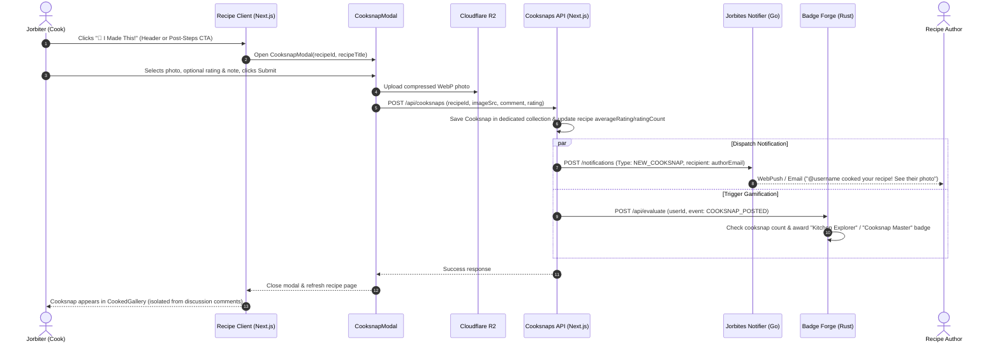

# Elevating "I Made This!" (Cooksnaps) Architecture & Workflow

This document details the end-to-end architecture, user experience, data flow, and cross-service communication workflow for **Cooksnaps** ("I Made This!") across the **Jorbites Next.js Web Application**, **Cloudflare R2**, **Jorbites Notifier (Go)**, and **Badge Forge (Rust)**.

---

## 🏗️ Architecture & Interaction Diagram

---

## 🌟 Key Components

### 1. Prominent Entry Points (CTAs) & Separation of Concerns
- **Header Action Bar**: A dedicated `"📸 I Made This!"` button in `RecipeInfoHeader.tsx` alongside Save, Like, and Likes counter.
- **Post-Steps Banner**: An engaging banner card immediately below the recipe preparation steps in `RecipeInfo.tsx` prompting cooks who just finished following the recipe to upload their photo.
- **Strict Separation from Regular Comments**:
  - Regular comments (`CommentBox`) retain the photo attachment button (`HiOutlineCamera`) for general pictures (e.g., questions about ingredient texture or progress), but attaching a photo in a comment does **NOT** mark it as a cooksnap.
  - The `"🥑 I Cooked This!"` checkbox is removed from `CommentBox`.
  - Cooksnaps are a **dedicated first-class entity** (`Cooksnap` collection in Prisma/MongoDB) created exclusively through `CooksnapModal` and `/api/cooksnaps`.
  - The `CookedGallery` exclusively displays entries from `Cooksnap`, while the `Comments` list displays only conversational discussion comments, eliminating visual duplication on screen.

### 2. Fast 1-Click Submission (`CooksnapModal.tsx`)
- Drag-and-drop or mobile camera upload.
- Client-side WebP compression (`compressImage`) to max 1080px with quality 0.82.
- Direct-to-R2 pre-signed upload via `/api/upload/r2`.
- Optional 1-sentence note (with automatic friendly fallback if empty).
- Optional 1–5 star rating using interactive `StarRating`.

### 3. "Cooked by the Community" Photo Gallery (`CookedGallery.tsx`)
- Horizontal snap-scrolling carousel on `RecipeClient.tsx`.
- Displays dish photos with cook avatar, display name, and optional star rating.
- Clicking any card opens `PhotoLightbox` for high-resolution viewing with cook notes.
- Includes an inviting empty state if no cooksnaps exist yet.

### 4. Author Notification Microservice (`jorbites-notifier` - Go)
- New notification type: `NEW_COOKSNAP`.
- Multilingual push notifications (`es`, `ca`, `en`): *"@username cooked your recipe! See their photo"*.
- Transactional email with direct link to view the photo on Jorbites.
- Integrated into user `social` notification category preferences.

### 5. Gamification & Progression (`badge_forge` - Rust)
- Event: `COOKSNAP_POSTED`.
- Microservice counts completed cooksnaps by the user in MongoDB.
- Progressive badge unlocking:
  - Tier 1: **"Kitchen Explorer"** (1 Cooksnap)
  - Tier 2: **"Cooksnap Veteran"** (5 Cooksnaps)
  - Tier 3: **"Cooksnap Master"** (15 Cooksnaps)
- Awards badges atomically and sends `NEW_BADGE` notification.
