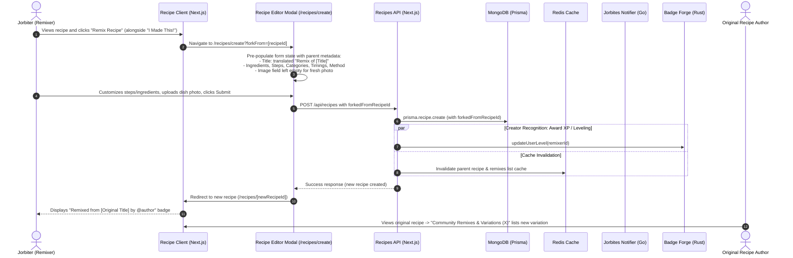

# Collaborative Cooking: "Remix / Fork Recipe" Architecture & Workflow

This document details the end-to-end architecture, user experience, data flow, and cross-service communication workflow for **Recipe Remixing / Forking** across the **Jorbites Next.js Web Application**, **MongoDB**, **Jorbites Notifier (Go)**, and **Badge Forge (Rust)**.

---

## 🏗️ Architecture & Interaction Diagram

---

## 🌟 Key Components

### 1. Dual Entry Points & Clean CTA

- **Post-Steps CTA**: A `"Remix Recipe"` button placed directly alongside the `"I Made This!"` button in `RecipeInfo.tsx` below the recipe steps, using the `TbGitFork` icon (no emojis).
- **Navigation Flow**: Clicking the button navigates to `/recipes/create?forkFrom=[recipeId]`.
- **Authentication Guard**: Unauthenticated users are prompted with `loginModal.onOpen()`.

### 2. Pre-filled Recipe Editor (`/recipes/create?forkFrom=[recipeId]`)

- **Query Parameter Support**: Visiting `/recipes/create?forkFrom=[recipeId]` fetches the original recipe and pre-fills the creation form.
- **Localized Title**: Pre-populates the recipe title with `t('remix_of', { title })` according to the cook's active language preference:
    - English: `"Remix of Grandma's Apple Pie"`
    - Spanish: `"Remix de Tarta de Manzana de la Abuela"`
    - Catalan: `"Remescla de Pastís de Poma de la Iaia"`
- **Copied Metadata**: Ingredients, preparation steps, categories, method, and prep/cook timings are duplicated for rapid tweaking.
- **Fresh Photo Requirement**: The primary dish image (`imageSrc`) starts blank so each home cook provides their own genuine photo, preventing duplicate image conflicts (`409 Conflict`).
- **Internal Reference**: The field `forkedFromRecipeId` is tracked internally and submitted to the API.

### 3. Attribution Badge & Backlink (`RemixAttributionBanner.tsx`)

- Displayed prominently at the top of the remixed recipe detail page.
- Displays: `"Remixed from [Original Recipe Title] by @originalAuthor"`.
- Clickable links route back to `/recipes/[originalRecipeId]` and the author's profile at `/profile/[originalAuthorId]`.
- Resilient to deleted original recipes (displays fallback attribution without crashing).

### 4. "Community Remixes & Variations" Gallery (`RecipeRemixesSection.tsx`)

- Conditionally rendered on the original recipe view below community cooksnaps only when community remixes exist (hidden when zero remixes exist to avoid redundant remix buttons alongside the primary action).
- Title: `"Community Remixes & Variations (X)"` with count badge.
- Responsive horizontal carousel (`ScrollableContainer`) displaying thumbnail, variation title, author avatar, and cook time.
- Direct remix CTA button in header inviting cooks to add their own variation.

### 5. Creator Recognition & Gamification

- **XP / Level Progression**:
    - The remixer is awarded recipe creation XP via `updateUserLevel({ userId: currentUser.id })`.
- **Cross-Service Notifications & Author Rewards** (Tracked in [#1752](https://github.com/jorbush/jorbites/issues/1752)):
    - Future integration with `jorbites-notifier` for `RECIPE_REMIX` email/web push alerts: `"@username published a remix of your recipe!"`.
    - Future integration with `badge_forge` for author recognition XP awards when community cooks publish variations of their recipes.

### 6. Cache Invalidation & Data Integrity

- Redis cache keys invalidated upon remix creation:
    - `recipe:[forkedFromRecipeId]`
    - `recipe:remixes:[forkedFromRecipeId]`
    - `recipes:graph:[userId]`
    - `recipes:global:version`
- When a remix is deleted, `recipe:remixes:[forkedFromRecipeId]` is purged to maintain real-time accuracy.
